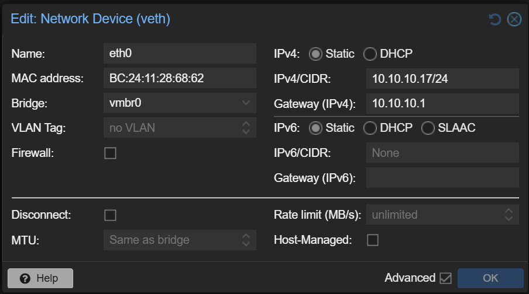
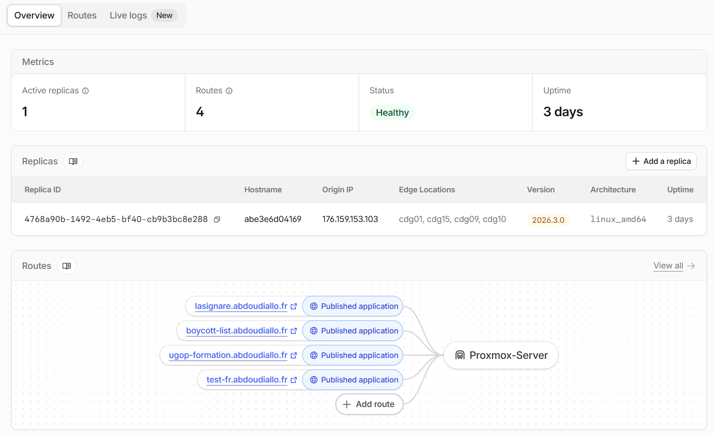
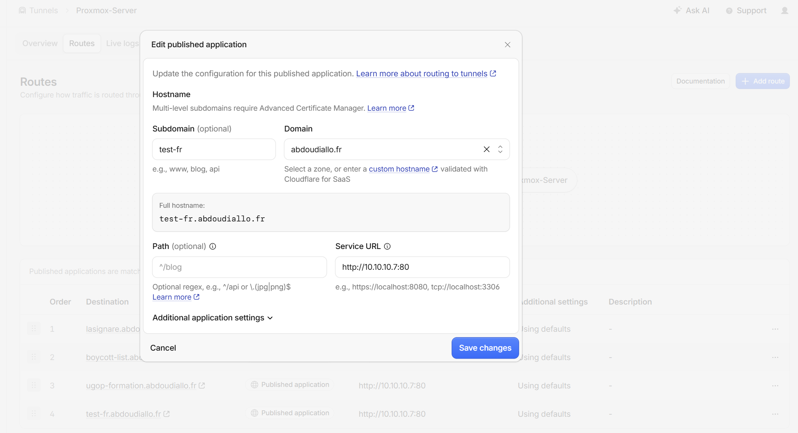
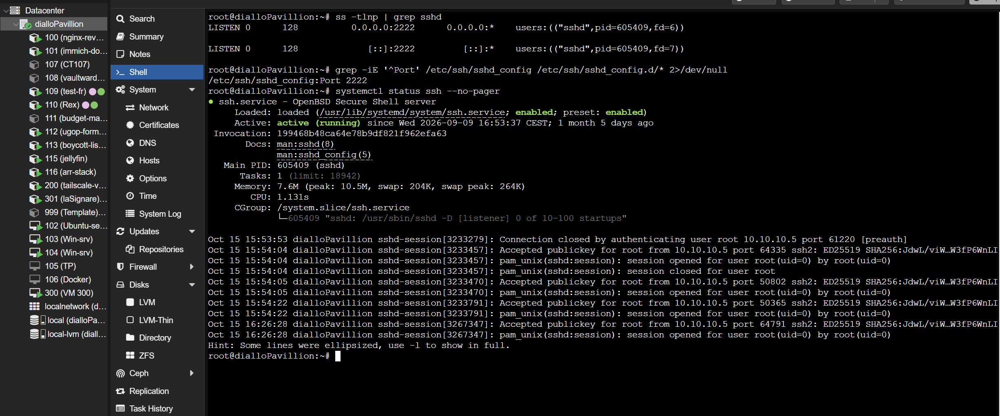
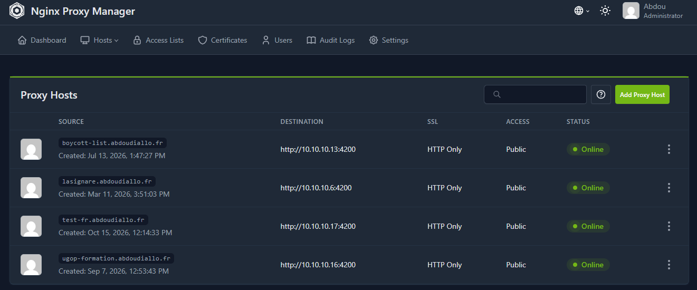
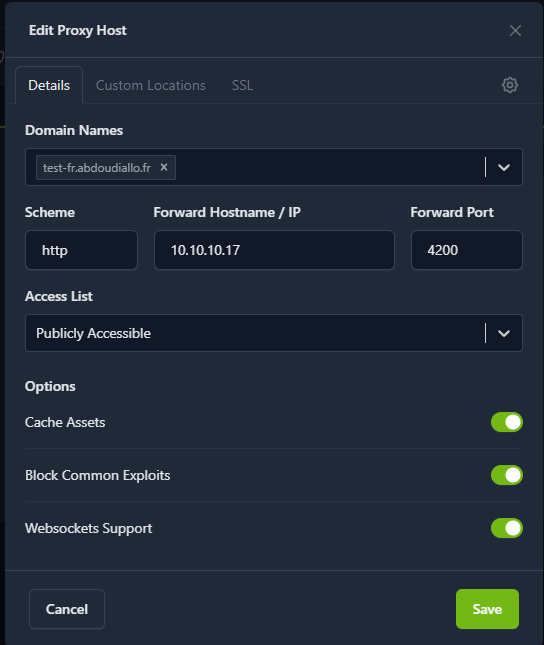

# Generic deployment guide — Proxmox / Cloudflare / Nginx Proxy Manager stack

A reusable playbook for deploying **any** containerised web application to dedicated
infrastructure: build on Windows, ship a Docker image, run it in a dedicated LXC, and
publish it on `<subdomain>.abdoudiallo.fr`.

Use it as a template: replace `<app>`, `<subdomain>`, `<LXC_ID>` and `<tag>` with the
target values. Concrete defaults from the reference setup are given throughout — these are
the values already deployed for `boycott-list`, `lasignare`, `ugop-formation` and `test-fr`.

> Reference implementation: the **prep-test-naturalisation** project. Its
> `auto_deploy.sh`, `Dockerfile`, `deploy/` folder and `GUIDE.md` are a working example
> of everything below — copy them as the starting point for a new app.

---

## 1. What the playbook delivers

| Goal                              | How                                                                                                             |
| --------------------------------- | --------------------------------------------------------------------------------------------------------------- |
| No registry, no CI, no Kubernetes | the image is built on Windows, `docker save`d to a `.tar`, copied by `scp`                                      |
| One command to deploy             | `sh auto_deploy.sh` (~2 min, cached build ~40 s)                                                                |
| Never ship a broken artefact      | the data/asset validation runs **inside** `docker build`; the built container is smoke-tested before it travels |
| Nothing open on the router        | Cloudflare Tunnel (the existing `Proxmox-Server` tunnel)                                                        |
| One reverse proxy for everything  | Nginx Proxy Manager on `10.10.10.7`, one Proxy Host per app                                                     |
| Boring, repeatable operations     | image tags, `docker load`, `compose down/up`, a health gate, a documented rollback                              |

---

## 2. The pipeline

```
Windows (cmdr)                         Proxmox host 192.168.1.55 (ssh :2222)      LXC <LXC_ID>
──────────────                         ──────────────────────────────────        ────────────
auto_deploy.sh
  1  docker build  (tests inside)
  2  docker run + /healthz  (local smoke test)
  3  docker save → dist/<app>-<tag>.tar
  4  scp ───────────────────────────►  /opt/<app>/
  5  ssh ────────────────────────────► deploy-lxc.sh
                                          └─ pct push ─────────────────────────►  /opt/<app>/
                                                                                    docker load
                                                                                    compose up -d
                                        ◄──── health = healthy ─────────────────────  /healthz
Cloudflare (tunnel Proxmox-Server) ──► http://10.10.10.7:80 (Nginx Proxy Manager)
                                        └─ Proxy Host <subdomain> → 10.10.10.<LXC_ID>:4200
```

Two network paths reach the app: **public** (Cloudflare → NPM → `10.10.10.<LXC_ID>:4200`)
and **local** (`http://10.10.10.<LXC_ID>:4200` from any machine on the LAN).

---

## 3. Conventions (defaults of the infrastructure)

| Item              | Value                                              | Why                                                                                                                                                                                                                     |
| ----------------- | -------------------------------------------------- | ----------------------------------------------------------------------------------------------------------------------------------------------------------------------------------------------------------------------- |
| Proxmox host      | `root@192.168.1.55`, **SSH port 2222**             | the sshd listens on 2222, not on 22; use `-p 2222` everywhere                                                                                                                                                           |
| LXC naming        | one LXC per app, `--hostname <subdomain>`          | matches NPM's routing and reads well in the Proxmox tree                                                                                                                                                                |
| LXC requirements  | `features: nesting=1,keyctl=1`                     | Docker inside an LXC                                                                                                                                                                                                    |
| App directory     | `/opt/<app>`                                       | on the host and inside the LXC (same path)                                                                                                                                                                              |
| Container port    | **8080** internal, published as **4200**           | 4200 is the convention for every app                                                                                                                                                                                    |
| LXC IP convention | `10.10.10.<LXC_ID>`                                | e.g. LXC 109 → `10.10.10.109`; older containers may not follow this convention, new ones will — always check with `hostname -I`; the past apps dont match the LXC_ID to the id in the ip adress but the first apps will |
| Reverse proxy     | Nginx Proxy Manager on `10.10.10.7`                | proxy `:80`, admin UI `:81`                                                                                                                                                                                             |
| Tunnel            | Cloudflare `Proxmox-Server`                        | every route → `http://10.10.10.7:80`                                                                                                                                                                                    |
| Windows shell     | cmder, default tab = **cmd.exe**                   | `VAR=value command` does **not** work there — use script options, or `set VAR=value && …`                                                                                                                               |
| Delivery          | `docker save` → `scp` → `pct push` → `docker load` | no registry credentials, works offline                                                                                                                                                                                  |

---

## 4. The four artefacts every project needs

### 4.1 `Dockerfile` — static site, two stages

```dockerfile
# syntax=docker/dockerfile:1.7

# Stage 1: run the checks INSIDE the image build. A failing test or an invalid
# data file aborts the build, so a broken artefact can never be shipped.
FROM node:22-alpine AS build
WORKDIR /app
COPY package.json ./
COPY data data
COPY assets assets
COPY tools tools
COPY index.html robots.txt ./
RUN node tools/validate-questions.mjs \
 && node tools/build-data.mjs

# Stage 2: non-root nginx serving the result on 8080
FROM nginxinc/nginx-unprivileged:1.27.5-alpine AS runtime
ARG VERSION=1.0.0
LABEL org.opencontainers.image.version="${VERSION}"
COPY deploy/nginx/default.conf /etc/nginx/conf.d/default.conf
COPY index.html /usr/share/nginx/html/index.html
COPY assets /usr/share/nginx/html/assets
COPY --from=build /app/data/questions.data.js /usr/share/nginx/html/data/questions.data.js
EXPOSE 8080
HEALTHCHECK --interval=30s --timeout=3s --start-period=5s --retries=3 \
  CMD wget -qO- http://127.0.0.1:8080/healthz >/dev/null 2>&1 || exit 1
CMD ["nginx", "-g", "daemon off;"]
```

Rules that matter: pin the base image; expose **only** `/healthz`; serve on **8080** as a non-root user; copy exactly what is served (nothing else); run the checks in stage 1 — for a static site, validating the source data and rebuilding the derived bundle is usually enough. Keep tests fast if any are added: they run on every build.

### 4.2 `deploy/docker-compose-prod.yml` — the single production file

```yaml
name: <app>

services:
  web:
    image: <app>:${TAG:-1.0.0}
    container_name: <app>
    restart: unless-stopped
    ports:
      - "${APP_PORT:-4200}:8080"
    read_only: true
    tmpfs:
      - /tmp:size=16m,mode=1777
      - /var/cache/nginx:size=16m
      - /var/run:size=1m
    cap_drop: [ALL]
    security_opt: ["no-new-privileges:true"]
    healthcheck:
      test: ["CMD", "wget", "-qO-", "http://127.0.0.1:8080/healthz"]
      interval: 30s
      timeout: 3s
      start_period: 5s
      retries: 3
    logging:
      driver: json-file
      options: { max-size: "10m", max-file: "3" }
```

No `build:`, no volumes, no `env_file` unless the app really needs one. `read_only` plus
`cap_drop: ALL` is free hardening for a static site — keep the `tmpfs` list, nginx needs
to write there.

### 4.3 `auto_deploy.sh` — the one command

Requirements, in this order:

1. **Options, not env prefixes** (cmd.exe cannot do `VAR=value command`):
   `--check`, `--tag`, `--port`, `--ssh-port`, `--lxc`, `--host`, `--remote-dir`,
   `--no-local-test`, `--help`. Keep env-var fallbacks for Git Bash/PowerShell.
   Add `--setup-key` (installs the public key once, then no prompts) and use an
   explicit SSH/SCP binary: **prefer Git's MSYS OpenSSH to Windows' own
   `System32\OpenSSH\ssh.exe`, which can hide its password prompt until ENTER is
   pressed** when the script runs under cmd.exe/cmder.
2. **Pre-flight probe of the SSH port, without a password** — fail in one second rather
   than after a two-minute build:
   ```sh
   PROBE=$(ssh -p "$SSH_PORT" -o ConnectTimeout=8 -o BatchMode=yes \
             -o PreferredAuthentications=none "$PROXMOX_HOST" true 2>&1 || true)
   case "$PROBE" in
       *"Permission denied"*) echo "SSH reachable on port $SSH_PORT" ;;
       *) echo "SSH unreachable — see --ssh-port/--host" >&2; exit 1 ;;
   esac
   ```
3. `docker build` with the tag.
4. **Local smoke test**: `docker run -d --rm -p 127.0.0.1:18080:8080 <image>`, poll
   `/healthz`, check the served payload size, then `docker rm -f`.
5. **Verify that the built image really contains the current source** — while it is up,
   and compare the SHA of a served file with the local one. A stale build cache serves
   an old file with no error at all, so this check is what makes it visible. Offer a
   `--no-cache` option for when it fires.
6. `docker save -o dist/<app>-<tag>.tar <image>`.
7. `ssh … "mkdir -p '<dir>'"` then a single `scp` of the archive + compose + scripts.
8. `ssh … "LXC_ID=… TAG=… APP_PORT=… sh <dir>/deploy-lxc.sh"`.
9. Print a summary: image, archive, LXC, port, public URL, log/stop commands.

### 4.4 `deploy/deploy-lxc.sh` + `deploy/deploy-inside-lxc.sh`

Split the remote work in two, so each part is small and re-runnable:

- **`deploy-lxc.sh`** runs on the **Proxmox host**: verify `pct status <LXC_ID>` is
  running (start it if not), `pct exec … mkdir -p <dir>`, `pct push` the archive +
  compose + the inner script, then
  `pct exec <LXC_ID> -- env TAG=… APP_PORT=… REMOTE_DIR=… sh <dir>/deploy-inside-lxc.sh`.
- **`deploy-inside-lxc.sh`** runs **inside the LXC**: detect `docker compose` vs
  `docker-compose`; refuse if `APP_PORT` is already published by **another** container —
  exclude the container itself by name, otherwise every redeploy aborts on the port it
  publishes itself; message naming both fixes (wrong LXC vs port taken); `compose down`; the
  `docker load`; `compose up -d`; poll `docker inspect --format '{{.State.Health.Status}}'`
  up to 30×2 s; on failure print the last 60 log lines and exit 1; finally
  `docker image prune -f`.

### 4.5 Repository layout to copy

```
<app>/
├── auto_deploy.sh                 one-command deploy
├── Dockerfile
├── docker-compose.yml             local build (http://localhost:8080)
├── GUIDE.md / DEPLOY.md           docs
├── deploy/
│   ├── docker-compose-prod.yml    deployed as-is
│   ├── deploy-lxc.sh              on the Proxmox host
│   ├── deploy-inside-lxc.sh       inside the LXC
│   └── nginx/default.conf         the container's nginx (8080, headers, /healthz)
│                                  serve JS/CSS with `expires -1`: filenames never change,
│                                  so a long cache keeps visitors on a stale file
└── <app sources>
```

---

## 5. One-time setup for a new app

The starting point is the **Template** LXC: a container whose only content is
`setup_dev_env.sh` — the provisioning script that installs the shared toolchain (Git,
Python, build tools, Java + Maven, Node LTS + Angular CLI, Docker Engine with the compose
plugin, MongoDB). A new application is a **clone of that template** with its own hostname,
resources and address; nothing is created from scratch.

**1. Clone the template and give the clone its identity**

```bash
# via the Proxmox UI: right-click the Template container → Clone → Full clone
# or on the host:
pct clone <template-id> <LXC_ID> --hostname <subdomain> --full --storage local-lvm
pct set <LXC_ID> --cores 2 --memory 2048           # per app: what it actually needs
pct set <LXC_ID> --net0 name=eth0,bridge=vmbr0,ip=10.10.10.<LXC_ID>/24,gw=10.10.10.1
pct set <LXC_ID> --onboot 1
pct start <LXC_ID>
```



_The network device of a clone: bridge `vmbr0`, static address `10.10.10.<LXC_ID>/24`,
gateway `10.10.10.1`. That convention is what lets a Proxy Host address any application as
`10.10.10.<LXC_ID>:4200` without further bookkeeping._

**2. Provision it** (only when the template has not been provisioned yet)

```bash
pct exec <LXC_ID> -- bash -c "cd /root && chmod +x setup_dev_env.sh && ./setup_dev_env.sh"
pct exec <LXC_ID> -- docker version --format '{{.Server.Version}}'
pct exec <LXC_ID> -- hostname -I                   # expect 10.10.10.<LXC_ID>
```

The script is reproduced in full in **Appendix B**; extend its package list when an
application needs something it does not install.

**3. Cloudflare route** — Zero Trust → Networks → Tunnels → **Proxmox-Server** → _Add
route_ → _Published application_: subdomain `<subdomain>`, domain `abdoudiallo.fr`,
service URL `http://10.10.10.7:80` (identical to every other route). Cloudflare creates the
DNS CNAME itself — never add an `A` record for that hostname.





**4. Nginx Proxy Manager** — admin UI on `10.10.10.7:81`, reached through a tunnel
(`ssh -p 2222 -L 81:10.10.10.7:81 root@<proxmox-host>`) → **Hosts → Proxy Hosts →
Add Proxy Host**:

| Field                 | Value                        |
| --------------------- | ---------------------------- |
| Domain Names          | `<subdomain>.abdoudiallo.fr` |
| Scheme                | `http`                       |
| Forward Hostname / IP | `10.10.10.<LXC_ID>`          |
| Forward Port          | `4200`                       |
| Block Common Exploits | on                           |
| Websockets Support    | off unless the app needs it  |

_SSL_ tab: Request a new SSL certificate (Let's Encrypt; HTTP-01 passes through
Cloudflare), Force SSL, HTTP/2, accept the terms, Save. Cloudflare stays on
**Full (strict)** — an NPM/Let's Encrypt certificate satisfies it.

COMMANDS ::

```bash
# COMMANDS TO CHECK THE SSH PORT
ss -tlnp | grep sshd
grep -iE '^Port' /etc/ssh/sshd_config /etc/ssh/sshd_config.d/* 2>/dev/null
systemctl status ssh --no-pager
```



_Proxmox: locating the SSH port of the host — the value that the deploy scripts need as
`--ssh-port` / `-p`, since this infrastructure listens on 2222 rather than 22._





**5. Optional hygiene** — Cloudflare `Speed → Optimization`: disable **Rocket Loader**
for the hostname (it rewrites `<script>` tags and breaks strict CSP setups).

---

## 6. Deploy, update, rollback

```bash
# deploy / update (from the project root, cmder)
sh auto_deploy.sh                       # current tag
sh auto_deploy.sh --tag 1.1.0           # first deployment of a new version
sh auto_deploy.sh --check               # docker + SSH only, no build
sh auto_deploy.sh --port 8095           # if 4200 is already used in that LXC
sh auto_deploy.sh --lxc 120 --tag 1.1.0 # another app/LXC

# logs, restart, stop (inside the LXC)
pct enter <LXC_ID>
cd /opt/<app>
docker compose -f docker-compose-prod.yml logs -f web
docker compose -f docker-compose-prod.yml restart
docker compose -f docker-compose-prod.yml down
docker compose -f docker-compose-prod.yml up -d

# rollback: the previous image is still loaded locally
docker load -i <app>-<previous-tag>.tar
TAG=<previous-tag> docker compose -f docker-compose-prod.yml up -d
```

Redeploys are safe by design: the in-LXC script **excludes the container itself** from the port
check — it still publishes the port until it is recreated — and aborts only when a
**different** container holds it.

**Fast redeploy, without re-transferring the archive** (the image is already in the LXC):

```bash
scp -P 2222 deploy/deploy-inside-lxc.sh root@192.168.1.55:/opt/<app>/
ssh -p 2222 root@192.168.1.55 "pct push <LXC_ID> /opt/<app>/deploy-inside-lxc.sh /opt/<app>/deploy-inside-lxc.sh"
ssh -p 2222 root@192.168.1.55 "pct exec <LXC_ID> -- env TAG=<tag> APP_PORT=4200 LXC_ID=<LXC_ID> REMOTE_DIR=/opt/<app> sh /opt/<app>/deploy-inside-lxc.sh"
```

If no keys are set up yet: `ssh-keygen -t ed25519` then
`ssh-copy-id -p 2222 root@192.168.1.55` — after that the deploy is password-free, or use
`sh auto_deploy.sh --setup-key` once.

---

## 7. Verification ladder

Always climb it in order; the layer that fails indicates where the problem is.

```bash
# 1. container (inside the LXC)
docker ps                                       # healthy, 0.0.0.0:4200->8080
curl -I http://127.0.0.1:4200/healthz           # 200 OK
docker inspect --format '{{index .Config.Labels "org.opencontainers.image.version"}}' <app>:<tag>

# 2. LAN, from a workstation (bypasses proxy and Cloudflare)
curl -I http://10.10.10.<LXC_ID>:4200/healthz
start  http://10.10.10.<LXC_ID>:4200

# 3. through the reverse proxy, from the Proxmox host (tests NPM routing)
curl -I http://10.10.10.7/healthz -H 'Host: <subdomain>.abdoudiallo.fr'

# 4. public
curl -I https://<subdomain>.abdoudiallo.fr/healthz
# 5. what the server actually sends must be the new code. Filenames never change
#    between releases, so this is the check that catches an image that was not
#    rebuilt, or a client-side cache. Grep for a string just added or removed.
docker exec <app> sh -c "wget -qO- http://127.0.0.1:8080/assets/js/app.js | grep -c '<string>'"
curl -s https://<subdomain>.abdoudiallo.fr/assets/js/app.js | grep -c '<string>'
# 6. is a CDN (Cloudflare) in front holding a stale copy? A brand-new browser never
#    reaches the origin, so this is the layer that fools "it is still there in a
#    fresh browser". A cache-busting query is a new key, forcing an origin fetch.
curl -sI https://<subdomain>.abdoudiallo.fr/assets/js/app.js | grep -iE "cf-cache-status|^age:|cache-control"
curl -s "https://<subdomain>.abdoudiallo.fr/assets/js/app.js?bust=1" | grep -c '<string>'
```

Application-level checks in the browser: the main screen loads, a full workflow runs,
the developer console shows **no CSP errors**, and (if the app stores data locally)
reloading keeps state — that also proves `localStorage` works on the new hostname.

---

## 8. Troubleshooting

| Symptom                                                                      | Cause                                                                                               | Fix                                                                                                                                                                                                                       |
| ---------------------------------------------------------------------------- | --------------------------------------------------------------------------------------------------- | ------------------------------------------------------------------------------------------------------------------------------------------------------------------------------------------------------------------------- |
| The deploy stalls at the transfer step until ENTER is pressed                | Windows' own `ssh.exe` hides its password prompt under cmd.exe/cmder                                | prefer Git's OpenSSH (`/usr/bin/ssh`), set `SSH_BIN`, or add `--setup-key` so there is no prompt at all                                                                                                                   |
| `'VAR' is not recognized as an internal or external command`                 | `VAR=value command` was typed in **cmd.exe**                                                        | use the script options, or `set VAR=value && sh …`                                                                                                                                                                        |
| `ssh: connect to host … port 22: Connection refused`                         | sshd listens on **2222**                                                                            | `--ssh-port 2222` (default in the template); check with `ss -tlnp \| grep sshd` on the host                                                                                                                               |
| `Permission denied (publickey,password)` in `--check`                        | normal: the probe tests the port, not authentication                                                | nothing to fix; the real deploy will ask for the password                                                                                                                                                                 |
| `COPY … ENOENT` during the build                                             | a test reads a file the build stage never copied                                                    | add it to the `COPY` list in stage 1                                                                                                                                                                                      |
| container `unhealthy`                                                        | the server inside did not start                                                                     | `docker logs <app>`                                                                                                                                                                                                       |
| `read-only file system`                                                      | `read_only`/`tmpfs` were modified                                                                   | restore them from the repo                                                                                                                                                                                                |
| `Port 4200 is already published in this LXC **by another container**`        | a different container holds the port, or the wrong LXC is targeted                                  | `--lxc <id>`, or `--port 8095` (and match it in the Proxy Host)                                                                                                                                                           |
| On a **redeploy**, that message names the container _itself_                 | the helper script inside the LXC predates the guard fix                                             | redeploy: the script is re-pushed before it runs                                                                                                                                                                          |
| NPM's _"Congratulations!"_ page                                              | no Proxy Host for that hostname                                                                     | add one (§5)                                                                                                                                                                                                              |
| `502` from NPM                                                               | Proxy Host exists, upstream down                                                                    | `docker ps` in the LXC; check port 4200 and the Forward Host                                                                                                                                                              |
| CSP errors after deploying                                                   | Cloudflare Rocket Loader rewriting `<script>`                                                       | disable it                                                                                                                                                                                                                |
| stale content served                                                         | the image was not rebuilt                                                                           | redeploy (the build regenerates the assets)                                                                                                                                                                               |
| A JS/CSS change does not show up after a deploy                              | the browser holds the old file: filenames never change, so a long cache on code is a trap           | serve code with `expires -1` (revalidate); a plain refresh then suffices                                                                                                                                                  |
| The served file is not the one just changed, and the deploy reported success | a stale Docker build cache reused an old layer — no error anywhere                                  | compare the SHA of a served file with the local one during the smoke test, and rebuild with `--no-cache`                                                                                                                  |
| The change is missing **even in a fresh browser**                            | a CDN in front (Cloudflare) holds the old file at its edge — a new browser never reaches the origin | look for `cf-cache-status: HIT`, purge that URL on abdoudiallo.fr Cache -> Configuration -> Purge Cache -> Custom Purge -> URL -> input the url // and set the zone's **Browser Cache TTL** to _Respect Existing Headers_ |
| Knowing what a built image really contains                                   | Docker is the only obvious way to look inside                                                       | unpack the saved archive instead: `docker save` produces an OCI tar whose layers can be read with any tar reader (see the project's `inspect-image.py`)                                                                   |
| `docker load: no such file`                                                  | archive not transferred                                                                             | rerun the deploy, check `ls -lh /opt/<app>`                                                                                                                                                                               |
| Docker-in-LXC `permission denied` on `/var/lib/docker`                       | missing `nesting=1,keyctl=1`                                                                        | add to `/etc/pve/lxc/<id>.conf`, `pct reboot <id>`                                                                                                                                                                        |

**No SSH available?** Two fallbacks: scp straight to the LXC's own sshd (`docker load`

- `compose up` from there), or serve the archive over HTTP from a local machine
  (`node tools/serve.mjs 8000`) and pull it with `curl` from the Proxmox web console.

---

## 9. Daily cheat sheet (previous habits → the new ones)

| Old habit (boycott-list)                                   | Now                                                                           |
| ---------------------------------------------------------- | ----------------------------------------------------------------------------- |
| `chmod +x auto_deploy.sh && ./auto_deploy.sh`              | same, or `sh auto_deploy.sh`                                                  |
| `docker build` + `docker save frontend.tar` + `scp`        | steps 1, 3, 4 of `auto_deploy.sh`                                             |
| one `pct push` per file                                    | `deploy-lxc.sh` pushes them all                                               |
| `docker load -i frontend.tar`                              | step 6/6                                                                      |
| `docker compose -f docker-compose-prod.yml up -d frontend` | automated, plus a health gate                                                 |
| `docker ps` / `docker logs frontend_boycott_list`          | `docker ps` / `docker logs <app>`                                             |
| `--force-recreate` after a broken state                    | rerun the deploy (it does `down` then `up -d`)                                |
| editing `.env` on the Proxmox web console                  | not needed: `auto_deploy.sh` passes `TAG`/`APP_PORT` as environment variables |

---

## 10. Why these choices (so they can be changed knowingly)

- **One LXC per app** — isolation, independent restarts, and each app gets a stable
  `10.10.10.<id>` address that the proxy targets. Cost: one container's overhead.
- **Port 4200 everywhere** — a single convention means the NPM Proxy Host is always
  `10.10.10.<LXC_ID>` + `4200`; no per-app port bookkeeping. Change one app only if the
  port is already taken in that LXC.
- **No registry** — `docker save`/`load` needs no credentials, works on an isolated LAN,
  and the archive is a few tens of MB. A registry becomes worthwhile when a second host
  or a CI runner appears.
- **Tests inside `docker build`** — the image is the release artefact; if it builds, the
  checks passed. That is what makes a one-command deploy safe without CI.
- **Non-root, read-only, no capabilities** — a static site needs none of them, and it
  removes whole classes of container escape.
- **Cloudflare Tunnel** — no ports open on the router, no certificate on the origin, and
  the public IP stays private. NPM still provides per-host certificates for the
  internal path.

---

## 11. New app checklist (20 minutes)

- [ ] `pct create <ID> … --hostname <subdomain> --features nesting=1,keyctl=1`, start it, install Docker
- [ ] Copy `Dockerfile`, `deploy/`, `auto_deploy.sh` from the reference project; rename `<app>` / ports
- [ ] `sh auto_deploy.sh --lxc <ID> --check` → SSH reachable
- [ ] `sh auto_deploy.sh --lxc <ID> --tag 1.0.0` → container healthy
- [ ] Verify layer 2 (`http://10.10.10.<ID>:4200/healthz`)
- [ ] Cloudflare: add the route → `http://10.10.10.7:80`
- [ ] NPM: add the Proxy Host → `10.10.10.<ID>:4200`, SSL tab with Let's Encrypt + Force SSL
- [ ] Verify layers 3 and 4, then the app in the browser (console clean, no CSP errors)
- [ ] Redeploy once with a new tag (`sh auto_deploy.sh --tag 1.0.1`) to prove the update path
- [ ] Write the app's own `GUIDE.md` from this template, with its specifics

---

## 12. Full-stack variant: Angular + Spring Boot/Quarkus + PostgreSQL

The static-site pattern of the preceding sections is the simple case. A full-stack
application adds a database and a second container, and the reverse proxy only ever talks
to the **frontend** — the API and the database stay on an internal network.

### 12.1 Angular (SSR) image

```dockerfile
FROM node:22-alpine AS build
WORKDIR /app

# Increase memory for the Angular build
ENV NODE_OPTIONS="--max-old-space-size=8192"

COPY package*.json ./
RUN npm ci
COPY . .
RUN npm run build

# Stage 2: Run the Angular SSR server
FROM node:22-alpine
WORKDIR /app
COPY --from=build /app/dist ./dist

ENV HOST=0.0.0.0
ENV PORT=4200
ENV NODE_OPTIONS="--max-old-space-size=4096"

EXPOSE 4200

ENTRYPOINT ["node", "--max-old-space-size=4096", "dist/frontend/server/server.mjs"]
```

Three decisions carry the whole file: `npm ci` (not `install`) reproduces the build from
`package-lock.json`; the build stage is given 8 GB of heap so a large Angular compilation
does not run out of memory; the runtime keeps the SSR server on **4200**, the port the
Proxy Host of §5 expects.

### 12.2 Spring Boot image

```dockerfile
# Stage 1: Build with Maven + JDK 25
FROM maven:3.9-eclipse-temurin-25 AS build
WORKDIR /app

# Maven is already installed – do NOT install it again

COPY pom.xml .
RUN mvn dependency:go-offline -B

COPY src ./src
RUN mvn clean package -DskipTests

# Stage 2: Run with JDK (instead of JRE, to use local image)
FROM eclipse-temurin:25-jdk
WORKDIR /app
COPY --from=build /app/target/backend-0.0.1-SNAPSHOT.jar app.jar

EXPOSE 8080
ENTRYPOINT ["java", "-Djava.security.egd=file:/dev/./urandom", "-jar", "app.jar"]
```

`pom.xml` is copied before `src/` on purpose: `dependency:go-offline` then sits in its own
layer, so the Maven repository is downloaded once and only a source change triggers a real
rebuild. Tests are skipped in the image because a release pipeline or the developer machine
already ran them — drop `-DskipTests` if the image itself must be the release gate.

### 12.3 Quarkus variant

```dockerfile
# Stage 1: build the Quarkus application
FROM maven:3.9-eclipse-temurin-25 AS build
WORKDIR /app

COPY pom.xml .
RUN mvn -B dependency:go-offline

COPY src ./src
RUN mvn -B clean package -DskipTests -Dquarkus.package.jar.type=fast-jar

# Stage 2: run the fast-jar layout
FROM eclipse-temurin:25-jdk
WORKDIR /app
COPY --from=build /app/target/quarkus-app /app/quarkus-app

EXPOSE 8080
ENTRYPOINT ["java", "-jar", "/app/quarkus-app/quarkus-run.jar"]
```

A Quarkus _fast-jar_ is a directory (`quarkus-run.jar` plus `lib/`, `app/` and `quarkus/`),
so the whole `quarkus-app` tree is copied rather than a single jar. For a native binary,
build with `-Dnative` on a `quay.io/quarkus/ubi-quarkus-native-image` stage and copy the
resulting executable — the port convention and the Proxy Host rules do not change.

### 12.4 `docker-compose-prod.yml` for the stack

```yaml
services:
  postgres:
    image: postgres:18-alpine
    restart: unless-stopped
    env_file:
      - .env
    environment:
      POSTGRES_DB: ${DB_NAME}
      POSTGRES_USER: ${DB_USERNAME}
      POSTGRES_PASSWORD: ${DB_PASSWORD}
    volumes:
      - pg-data:/var/lib/postgresql
    healthcheck:
      test: ["CMD-SHELL", "pg_isready -U ${DB_USERNAME} -d ${DB_NAME}"]
      interval: 5s
      timeout: 5s
      retries: 5
    networks:
      - internal-app-network

  backend:
    image: boycott-list-backend:latest
    restart: unless-stopped
    container_name: backend_boycott_list
    ports:
      - "8080:8080"
    volumes:
      - ./backups:/backups
    depends_on:
      postgres:
        condition: service_healthy
    env_file:
      - .env
    environment:
      - SPRING_PROFILES_ACTIVE=dev
      - SPRING_DATASOURCE_URL=jdbc:postgresql://postgres:5432/${DB_NAME}
      - SPRING_DATASOURCE_USERNAME=${DB_USERNAME}
      - SPRING_DATASOURCE_PASSWORD=${DB_PASSWORD}
      - SPRING_JPA_HIBERNATE_DDL_AUTO=update
      - SPRING_JPA_DATABASE_PLATFORM=org.hibernate.dialect.PostgreSQLDialect
      # Notification vars
      - DISCORD_WEBHOOK_URL=${DISCORD_WEBHOOK_URL}
      - NOTIFICATION_EMAIL_TO=${NOTIFICATION_EMAIL_TO}
      - NOTIFICATION_EMAIL_ENABLED=true
      - SPRING_MAIL_HOST=${SPRING_MAIL_HOST}
      - SPRING_MAIL_PORT=${SPRING_MAIL_PORT}
      - SPRING_MAIL_USERNAME=${SPRING_MAIL_USERNAME}
      - SPRING_MAIL_PASSWORD=${SPRING_MAIL_PASSWORD}
      - SPRING_MAIL_PROPERTIES_MAIL_SMTP_AUTH=${SPRING_MAIL_PROPERTIES_MAIL_SMTP_AUTH}
      - SPRING_MAIL_PROPERTIES_MAIL_SMTP_STARTTLS_ENABLE=${SPRING_MAIL_PROPERTIES_MAIL_SMTP_STARTTLS_ENABLE}
    networks:
      - internal-app-network
      - proxy-network

  frontend:
    image: boycott-list-frontend:latest
    restart: unless-stopped
    container_name: frontend_boycott_list
    ports:
      - "4200:4200"
    networks:
      - proxy-network
      - internal-app-network

networks:
  proxy-network:
    external: true
  internal-app-network:
    driver: bridge

volumes:
  pg-data:
```

What each decision buys:

| Element                                         | Effect                                                                                               |
| ----------------------------------------------- | ---------------------------------------------------------------------------------------------------- |
| `proxy-network` declared **external**           | compose attaches to the network the reverse proxy already uses instead of creating its own           |
| only `frontend` joins `proxy-network`           | one published entry point; the API and the database are reachable only inside `internal-app-network` |
| `backend` publishes `8080`                      | convenient for LAN debugging; the `ports:` block can be removed when the API must stay private       |
| `depends_on: condition: service_healthy`        | the API starts only after `pg_isready` succeeds, which removes the usual boot-time connection errors |
| `env_file: .env` and `${…}` interpolation       | credentials and mail settings stay out of the compose file; `.env` must never be committed           |
| named volume `pg-data`                          | the database survives `compose down` and recreation, unlike an anonymous volume                      |
| bind-mounted `./backups`                        | a predictable place on the LXC for dumps                                                             |
| `restart: unless-stopped` on all three services | the stack returns by itself after a reboot of the container or the host                              |

### 12.5 Shipping a multi-image stack

`auto_deploy.sh` (Appendix A) saves a single image. A stack needs every image in one
archive, and the health gate must watch the container that serves traffic:

```bash
docker build -t <app>-backend:${TAG}  -t <app>-backend:latest  ./backend
docker build -t <app>-frontend:${TAG} -t <app>-frontend:latest ./frontend
docker save -o dist/<app>-${TAG}.tar <app>-backend:${TAG} <app>-frontend:${TAG}
```

Inside the LXC, one `docker load -i dist/<app>-${TAG}.tar` imports both images, then
`TAG=${TAG} docker compose -f docker-compose-prod.yml up -d` starts the three services.
Poll the frontend for the health gate and, when the API exposes one, its health endpoint
too: a stack whose database or API is unhealthy must fail the deployment rather than be
reported as successful.

The Proxy Host is unchanged from §5 — `<subdomain>.abdoudiallo.fr` → `10.10.10.<LXC_ID>:4200`
— because the SSR server is the only component the reverse proxy needs to reach.

### 12.6 The full-stack deploy script in use

A real example, for a two-image stack (`boycott-list`, deployed to LXC 113): two images, one
compose file, three services. It is the multi-image counterpart of Appendix A.

```bash
#!/bin/bash
set -e  # stop on any error

# ------------------------------------------------------------------
# CONFIGURATION
# ------------------------------------------------------------------
PROXMOX_HOST="root@192.168.1.55"
LXC_ID="113"
REMOTE_DIR="/opt/boycott-list"

# ------------------------------------------------------------------
# Step 1: Build & transfer frontend image
# ------------------------------------------------------------------
echo "🛠  Building frontend image..."
cd frontend
docker build -t boycott-list-frontend:latest .
docker save boycott-list-frontend:latest -o frontend.tar
echo "📤 Uploading frontend.tar to Proxmox host..."
scp frontend.tar ${PROXMOX_HOST}:${REMOTE_DIR}/
cd ..

# ------------------------------------------------------------------
# Step 2: Build & transfer backend image
# ------------------------------------------------------------------
echo "🛠  Building backend image..."
cd backend
docker build -t boycott-list-backend:latest .
docker save boycott-list-backend:latest -o backend.tar
echo "📤 Uploading backend.tar to Proxmox host..."
scp backend.tar ${PROXMOX_HOST}:${REMOTE_DIR}/
cd ..

# ------------------------------------------------------------------
# Step 3: Copy Docker Compose files
# ------------------------------------------------------------------
echo "📄 Copying docker-compose files..."
scp docker-compose-prod.yml ${PROXMOX_HOST}:${REMOTE_DIR}/

# ------------------------------------------------------------------
# Step 4: Push files from Proxmox host to LXC container
# ------------------------------------------------------------------
echo "🚚 Pushing files into LXC ${LXC_ID}..."
ssh ${PROXMOX_HOST} <<EOF
  pct push ${LXC_ID} ${REMOTE_DIR}/backend.tar ${REMOTE_DIR}/backend.tar
  pct push ${LXC_ID} ${REMOTE_DIR}/frontend.tar ${REMOTE_DIR}/frontend.tar
  pct push ${LXC_ID} ${REMOTE_DIR}/docker-compose.yml ${REMOTE_DIR}/docker-compose.yml
  pct push ${LXC_ID} ${REMOTE_DIR}/docker-compose-prod.yml ${REMOTE_DIR}/docker-compose-prod.yml
EOF

# ------------------------------------------------------------------
# Step 5: Deploy inside LXC
# ------------------------------------------------------------------
echo "🚀 Deploying new images inside LXC ${LXC_ID}..."
ssh ${PROXMOX_HOST} "pct exec ${LXC_ID} -- bash -c '
  cd ${REMOTE_DIR}
  docker-compose -f docker-compose-prod.yml down
  docker load -i frontend.tar
  docker-compose -f docker-compose-prod.yml up -d frontend
  docker load -i backend.tar
  docker-compose -f docker-compose-prod.yml up -d backend
'"

echo "✅ Redeployment complete!"
```

What is worth changing before reusing it for another stack:

| Point                                            | Reason                                                                                                                                                                             |
| ------------------------------------------------ | ---------------------------------------------------------------------------------------------------------------------------------------------------------------------------------- |
| `scp` and `ssh` are called without a port        | this infrastructure listens on **2222**, not 22, so both need `-P 2222` / `-p 2222`; Appendix A derives the port from an option                                                    |
| `docker-compose` (v1)                            | the containers ship the compose **v2 plugin**: `docker compose` is what the compose files assume and what is maintained                                                            |
| the `docker-compose.yml` line in step 4          | that file exists in few projects — only `docker-compose-prod.yml` is deployed; with `set -e`, a failed `pct push` aborts the whole run                                             |
| no health gate                                   | the script ends when `up -d` returns, so a container that starts and immediately crashes is reported as success; Appendix A polls the health status and prints the logs on failure |
| hardcoded `PROXMOX_HOST`, `LXC_ID`, `REMOTE_DIR` | turning them into options/environment variables (Appendix A) makes one script serve every application                                                                              |
| `up -d frontend` then `up -d backend`            | per-service startup works, but `up -d` on the whole file also applies `depends_on` and starts the database in the right order                                                      |
| emoji in the status lines                        | harmless interactively; plain ASCII is safer when output is captured by CI or a non-UTF-8 locale                                                                                   |

> The two scripts are complementary rather than competing: Appendix A is the single-image,
> option-driven, health-gated version used by the static application described in this
> playbook; the script above is the straightforward two-image version that shipped
> `boycott-list`.

---

## Appendix A — the complete `auto_deploy.sh`

This is the generic form of the script that deploys this project. Copy it next to the
`Dockerfile`, replace every `<placeholder>`, and the whole chain — build, local test,
`docker save`, transfer, `pct push`, `docker load`, health gate — runs from one command.
§4.3 explains why each step exists; §4.4 covers the two helpers it calls on the remote side.

Placeholders: `<app>`, `<subdomain>`, `<domain>`, `<proxmox-host>`, `<ssh-port>`,
`<LXC_ID>`, `<app-port>`. The smoke test compares the SHA of `assets/js/app.js` with the
copy the built container serves — point that at a file the application actually serves.

```sh
#!/usr/bin/env sh
# =============================================================================
# <app> — one-command deployment
#
#   sh auto_deploy.sh                       deploys (LXC 109, port <app-port>, ssh <ssh-port>)
#   sh auto_deploy.sh --check               checks docker + SSH, then stops
#   sh auto_deploy.sh --tag 1.1.0           new image tag
#   sh auto_deploy.sh --port 8095           if <app-port> is already taken in the LXC
#   sh auto_deploy.sh --ssh-port 22         another ssh port
#   sh auto_deploy.sh --lxc 120             another container
#   sh auto_deploy.sh --help                all the options
#
# The same path as boycott-list:
#   1. checks (including an SSH probe, without a password)
#   2. docker build      (the checks run inside the image)
#   3. local test        container on 127.0.0.1:18080, /healthz probe + SHA check
#   4. docker save       → dist/<app>-<tag>.tar
#   5. scp + pct push    → /opt/<app> inside the LXC
#   6. docker load + compose up -d in the LXC, waiting for the probe
#
# Three Proxmox passwords are requested (remote directory, copy, execution).
# To stop typing them: ssh-keygen -t ed25519 then
#   ssh-copy-id -p <ssh-port> root@<proxmox-host>
#   — or simply: sh auto_deploy.sh --setup-key
#
# NOTE cmd.exe / cmder: the form "VARIABLE=value command" does not exist under
# cmd.exe, hence the options above. cmd equivalent if preferred:
#   set SSH_PORT=<ssh-port> && sh auto_deploy.sh --check
# =============================================================================
set -e

PROXMOX_HOST="${PROXMOX_HOST:-root@<proxmox-host>}"
SSH_PORT="${SSH_PORT:-<ssh-port>}"
LXC_ID="${LXC_ID:-<LXC_ID>}"
REMOTE_DIR="${REMOTE_DIR:-/opt/<app>}"
TAG="${TAG:-1.0.0}"
APP_PORT="${APP_PORT:-<app-port>}"
CHECK_ONLY="${CHECK_ONLY:-no}"
LOCAL_TEST="${LOCAL_TEST:-yes}"
TEST_PORT="${TEST_PORT:-18080}"
SETUP_KEY="${SETUP_KEY:-no}"
NO_CACHE="${NO_CACHE:-no}"

# OpenSSH binaries. Git for Windows' bundled ssh/scp (MSYS) show their password
# prompt immediately; Windows' own C:\Windows\System32\OpenSSH\ssh.exe may wait for a
# stray ENTER before displaying it when the script runs under cmd.exe/cmder.
# The MSYS build is preferred; override with SSH_BIN / SCP_BIN.
if [ -z "${SSH_BIN:-}" ]; then
    if [ -x /usr/bin/ssh ]; then SSH_BIN=/usr/bin/ssh; else SSH_BIN=ssh; fi
fi
if [ -z "${SCP_BIN:-}" ]; then
    if [ -x /usr/bin/scp ]; then SCP_BIN=/usr/bin/scp; else SCP_BIN=scp; fi
fi

usage() {
    cat <<'HELP'
<app> — build, transfer and deploy to the LXC

  sh auto_deploy.sh [options]

Options:
  --check                 checks docker + SSH then stops (no build)
  --setup-key             installs the public key on the Proxmox host (no more passwords)
  --no-cache              ignores the Docker build cache (fixes a stale layer)
  --tag <tag>             image tag                             (default 1.0.0)
  --port <port>           port published in the LXC             (default <app-port>)
  --ssh-port <port>       ssh port of the Proxmox host          (default <ssh-port>)
  --lxc <id>              target LXC container                  (default <LXC_ID>)
  --host <user@host>      Proxmox host                          (default root@<proxmox-host>)
  --remote-dir <path>     remote directory                      (default /opt/<app>)
  --no-local-test         skips the local container test
  -h, --help              shows this help

Examples:
  sh auto_deploy.sh
  sh auto_deploy.sh --check
  sh auto_deploy.sh --tag 1.1.0
  sh auto_deploy.sh --port 8095 --lxc 120
  sh auto_deploy.sh --setup-key

The same settings exist as environment variables (PROXMOX_HOST,
SSH_PORT, LXC_ID, REMOTE_DIR, TAG, APP_PORT, LOCAL_TEST, NO_CACHE, SSH_BIN, SCP_BIN) — but
use the options or "set VAR=value && sh auto_deploy.sh".
AIDE
}

POSITIONALS=0
while [ "$#" -gt 0 ]; do
    case "$1" in
        --check)                       CHECK_ONLY="yes" ;;
        --setup-key)                   SETUP_KEY="yes" ;;
        --no-cache)                    NO_CACHE="yes" ;;
        --tag)                         shift; TAG="${1:?--tag expects a value}" ;;
        --port|--app-port)             shift; APP_PORT="${1:?--port expects a value}" ;;
        --ssh-port)                    shift; SSH_PORT="${1:?--ssh-port expects a value}" ;;
        --lxc)                         shift; LXC_ID="${1:?--lxc expects a value}" ;;
        --host)                        shift; PROXMOX_HOST="${1:?--host expects a value}" ;;
        --remote-dir)                  shift; REMOTE_DIR="${1:?--remote-dir expects a value}" ;;
        --no-local-test)   LOCAL_TEST="no" ;;
        -h|--help)                     usage; exit 0 ;;
        -*)                            echo "Unknown option: $1" >&2; usage >&2; exit 1 ;;
        *)                             if [ "$POSITIONALS" -eq 0 ]; then TAG="$1"; POSITIONALS=1
                                       elif [ "$POSITIONALS" -eq 1 ]; then APP_PORT="$1"; POSITIONALS=2
                                       else echo "Too many arguments: $1" >&2; exit 1; fi ;;
    esac
    shift
done

if [ "$SETUP_KEY" = "yes" ]; then
    echo "Copying the public key to $PROXMOX_HOST (port $SSH_PORT) — after this, no more passwords."
    if command -v ssh-copy-id >/dev/null 2>&1; then
        ssh-copy-id -p "$SSH_PORT" "$PROXMOX_HOST"
    else
        PUB=$(ls "$HOME"/.ssh/*.pub 2>/dev/null | head -n 1)
        [ -n "$PUB" ] || { echo "No public key found. Generate one first: ssh-keygen -t ed25519" >&2; exit 1; }
        "$SSH_BIN" -p "$SSH_PORT" "$PROXMOX_HOST" "mkdir -p ~/.ssh && chmod 700 ~/.ssh && cat >> ~/.ssh/authorized_keys && chmod 600 ~/.ssh/authorized_keys && echo 'key installed'" < "$PUB" || exit 1
    fi
    exit 0
fi

ROOT_DIR=$(cd "$(dirname "$0")" && pwd)
cd "$ROOT_DIR"

IMAGE="<app>:$TAG"
ARCHIVE="<app>-$TAG.tar"

banner() {
    printf '\n=== %s\n' "$1"
}

banner "1/6 Checks"
command -v docker >/dev/null 2>&1 || { echo "docker was not found in the PATH." >&2; exit 1; }
command -v "$SCP_BIN" >/dev/null 2>&1 || { echo "scp was not found (OpenSSH). Install Git for Windows, or set SCP_BIN." >&2; exit 1; }
command -v "$SSH_BIN" >/dev/null 2>&1 || { echo "ssh was not found (OpenSSH). Install Git for Windows, or set SSH_BIN." >&2; exit 1; }
docker info >/dev/null 2>&1 || { echo "The Docker daemon is not responding: start Docker Desktop." >&2; exit 1; }
echo "    docker OK · target $PROXMOX_HOST:$SSH_PORT (LXC $LXC_ID, $REMOTE_DIR) · tag $TAG · port $APP_PORT"

# SSH probe: the PORT is tested without attempting authentication (therefore
# without a password). A reachable server answers "Permission denied"; a closed
# port or an unreachable host answers something else — the script stops BEFORE building
# the image.
PROBE=$("$SSH_BIN" -p "$SSH_PORT" -o ConnectTimeout=8 -o BatchMode=yes -o PreferredAuthentications=none "$PROXMOX_HOST" true 2>&1 || true)
case "$PROBE" in
    *"Permission denied"*)
        echo "    SSH reachable on port $SSH_PORT"
        ;;
    *)
        echo "    ! SSH unreachable at $PROXMOX_HOST (port $SSH_PORT)" >&2
        echo "      response: $(printf '%s' "$PROBE" | head -n 1)" >&2
        echo "      · sshd may be listening on another port:" >&2
        echo "            sh auto_deploy.sh --ssh-port 22" >&2
        echo "      · or the host has changed:" >&2
        echo "            sh auto_deploy.sh --host root@10.0.0.5" >&2
        echo "      · first connection to this host:" >&2
        echo "            ssh -p $SSH_PORT $PROXMOX_HOST    (to accept the key)" >&2
        echo "      · diagnostics:" >&2
        echo "            from this machine: ssh -v -p $SSH_PORT $PROXMOX_HOST" >&2
        echo "            on the host      : ss -tlnp | grep sshd" >&2
        exit 1
        ;;
esac

if [ "$CHECK_ONLY" = "yes" ]; then
    echo "    --check: checks completed, stopping before the build."
    exit 0
fi

banner "2/6 Building the image $IMAGE"
echo "    (the checks run inside the build)"
OPTIONS_BUILD=""
[ "$NO_CACHE" = "yes" ] && OPTIONS_BUILD="--no-cache"
# shellcheck disable=SC2086
docker build $OPTIONS_BUILD --build-arg "VERSION=$TAG" -t "$IMAGE" -t "<app>:latest" .

banner "3/6 Local container test"
if [ "$LOCAL_TEST" = "no" ]; then
    echo "    skipped (--no-local-test)"
elif ! command -v curl >/dev/null 2>&1; then
    echo "    skipped: curl is missing from this shell"
else
    CID=$(docker run -d --rm -p "127.0.0.1:$TEST_PORT:8080" "$IMAGE")
    HEALTHY="no"
    i=0
    while [ "$i" -lt 20 ]; do
        if curl -fsS "http://127.0.0.1:$TEST_PORT/healthz" >/dev/null 2>&1; then
            HEALTHY="yes"
            break
        fi
        i=$((i + 1))
        sleep 1
    done

    # The image must contain the CURRENT code: a stale build cache serves an old file
    # without any visible error. Compare a served asset with the local one, while the
    # container is still up.
    HASH_OK="no"
    if [ "$HEALTHY" = "yes" ] && command -v sha256sum >/dev/null 2>&1; then
        HASH_LOCAL=$(sha256sum assets/js/app.js | cut -c1-12)
        HASH_SERVED=$(curl -fsS "http://127.0.0.1:$TEST_PORT/assets/js/app.js" | sha256sum | cut -c1-12)
        if [ "$HASH_LOCAL" != "$HASH_SERVED" ]; then
            echo "    FAILURE: the image does not serve the current assets/js/app.js" >&2
            echo "      local  : $HASH_LOCAL" >&2
            echo "      served : $HASH_SERVED" >&2
            echo "      Cause: a stale build cache. Rerun with --no-cache." >&2
            docker rm -f "$CID" >/dev/null 2>&1 || true
            exit 1
        fi
        HASH_OK="yes"
    fi

    docker rm -f "$CID" >/dev/null 2>&1 || true
    if [ "$HEALTHY" != "yes" ]; then
        echo "    FAILURE: the /healthz probe does not answer on port $TEST_PORT" >&2
        exit 1
    fi
    echo "    /healthz 200 · the served code matches the local file"
    if [ "$HASH_OK" = "yes" ]; then
        echo "    assets/js/app.js byte-identical to the local file"
    fi

fi

banner "4/6 Exporting the image"
mkdir -p dist
docker save "$IMAGE" -o "dist/$ARCHIVE"
ls -lh "dist/$ARCHIVE" | sed 's/^/    /'

banner "5/6 Sending to $PROXMOX_HOST:$REMOTE_DIR"
"$SSH_BIN" -p "$SSH_PORT" "$PROXMOX_HOST" "mkdir -p '$REMOTE_DIR'"

FILES="dist/$ARCHIVE deploy/docker-compose-prod.yml deploy/deploy-lxc.sh deploy/deploy-inside-lxc.sh"
# shellcheck disable=SC2086
"$SCP_BIN" -P "$SSH_PORT" $FILES "$PROXMOX_HOST:$REMOTE_DIR/"

banner "6/6 pct push into LXC $LXC_ID, docker load and restart"
"$SSH_BIN" -p "$SSH_PORT" "$PROXMOX_HOST" "LXC_ID='$LXC_ID' REMOTE_DIR='$REMOTE_DIR' TAG='$TAG' APP_PORT='$APP_PORT' sh '$REMOTE_DIR/deploy-lxc.sh'"

cat <<FIN

    image         : $IMAGE
    archive       : dist/$ARCHIVE
    LXC container : $LXC_ID  (directory $REMOTE_DIR)
    published port: $APP_PORT → 8080 in the LXC
    public URL    : https://<subdomain>.<domain>

    TO CHECK (only once):

      1. Cloudflare · Zero Trust → Networks → Tunnels → Proxmox-Server
         → Add route → Published application
             Subdomain : <subdomain>
             Domain    : <domain>
             Service   : http://10.10.10.7:80      (like the other routes)

      2. Nginx Proxy Manager (10.10.10.7:81) → Hosts → Proxy Hosts → Add Proxy Host
             Domain Names          : <subdomain>.<domain>
             Scheme                : http
             Forward Hostname / IP : 10.10.10.$LXC_ID
             Forward Port          : $APP_PORT
         SSL tab: Request a new certificate, Force SSL, HTTP/2, Save.
         Admin UI via tunnel: ssh -p $SSH_PORT -L 81:10.10.10.7:81 $PROXMOX_HOST

    logs / stop:
      pct enter $LXC_ID
      cd $REMOTE_DIR
      docker compose -f docker-compose-prod.yml logs -f web
      docker compose -f docker-compose-prod.yml down
FIN
```

> Nothing here is magic: `--setup-key` removes the passwords, `--check` stops after the
> pre-flight, and `--no-cache` ignores the Docker build cache when a stale layer is suspected.

---

## Appendix B — `setup_dev_env.sh`, the template container's provisioning script

The Template LXC contains this single file. It installs the shared toolchain — Git, Python 3
with pip and venv, the C/C++ build tools, **OpenJDK 25 + Maven**, **Node.js LTS + Angular
CLI**, tmux, **Docker Engine** with the Buildx and Compose plugins, and **MongoDB 7** — then
prints every installed version. Run it once per container:

```bash
chmod +x setup_dev_env.sh
sudo ./setup_dev_env.sh
```

```bash
#!/bin/bash

# >/dev/null 2>&1 hides installation outputs
# can add the needed dependencies to list

GREEN="\e[32m"
YELLOW="\e[33m"
RED="\e[31m"
RESET="\e[0m"

log() {
  echo -e "${GREEN}[INFO]${RESET} $1"
}

warn() {
  echo -e "${YELLOW}[WARN]${RESET} $1"
}

fail() {
  echo -e "${RED}[ERROR]${RESET} $1"
  exit 1
}

error_handler() {
  fail "Command failed: '$BASH_COMMAND' (line $1)"
}

trap 'error_handler $LINENO' ERR

set -e  # stop script if a command fails

log "Updating system packages..."
apt update -y >/dev/null 2>&1
apt upgrade -y >/dev/null 2>&1

log "Installing Git..."
apt install -y git >/dev/null 2>&1

log "Installing Python 3 and pip..."
apt install -y python3 python3-pip python3-venv >/dev/null 2>&1

log "Installing C/C++ compiler and build tools (gcc, make)..."
apt install -y build-essential >/dev/null 2>&1

log "Installing Java (OpenJDK 25) and Maven..."
apt install -y openjdk-25-jdk maven >/dev/null 2>&1

log "Installing curl and ca-certificates..."
apt install -y curl ca-certificates >/dev/null 2>&1

log "Installing Node.js (LTS) and npm..."
curl -fsSL https://deb.nodesource.com/setup_lts.x | bash - >/dev/null 2>&1
apt install -y nodejs >/dev/null 2>&1

log "Installing Angular CLI..."
npm install -g @angular/cli >/dev/null 2>&1

log "Installing tmux..."
apt install -y tmux >/dev/null 2>&1

# --- DOCKER INSTALLATION ---
log "Adding Docker GPG key..."
install -m 0755 -d /etc/apt/keyrings
curl -fsSL https://download.docker.com/linux/ubuntu/gpg | gpg --dearmor -o /etc/apt/keyrings/docker.gpg >/dev/null 2>&1
chmod a+r /etc/apt/keyrings/docker.gpg

log "Adding Docker repository..."
echo \
  "deb [arch="$(dpkg --print-architecture)" signed-by=/etc/apt/keyrings/docker.gpg] https://download.docker.com/linux/ubuntu \
  "$(. /etc/os-release && echo "$VERSION_CODENAME")" stable" | \
  tee /etc/apt/sources.list.d/docker.list >/dev/null

log "Installing Docker Engine & Docker Compose..."
apt update -y >/dev/null 2>&1
apt install -y docker-ce docker-ce-cli containerd.io docker-buildx-plugin docker-compose-plugin >/dev/null 2>&1

log "Starting and enabling Docker..."
systemctl start docker >/dev/null 2>&1
systemctl enable docker >/dev/null 2>&1
# ---------------------------

log "Installing prerequisites for MongoDB..."
apt install -y gnupg >/dev/null 2>&1

log "Adding MongoDB repository..."
curl -fsSL https://www.mongodb.org/static/pgp/server-7.0.asc | \
gpg --dearmor -o /usr/share/keyrings/mongodb-server-7.0.gpg >/dev/null 2>&1

echo "deb [ arch=amd64,arm64 signed-by=/usr/share/keyrings/mongodb-server-7.0.gpg ] https://repo.mongodb.org/apt/ubuntu jammy/mongodb-org/7.0 multiverse" \
| tee /etc/apt/sources.list.d/mongodb-org-7.0.list >/dev/null

log "Installing MongoDB..."
apt update -y >/dev/null 2>&1
apt install -y mongodb-org >/dev/null 2>&1

log "Starting MongoDB..."
systemctl start mongod >/dev/null 2>&1
systemctl enable mongod >/dev/null 2>&1

echo ""
log "MongoDB status: active (running) means its all good"
systemctl status mongod --no-pager
# --no-pager prevents systemctl status from opening the pager (q exit screen)

echo ""
log "Installed versions:"
java -version
echo ""
mvn -version
echo ""
python3 --version
pip3 --version
echo ""
gcc --version | head -n 1
echo ""
node -v
npm -v
echo ""
ng version
echo ""
docker -v
docker compose version

echo ""
log "Setup completed."

echo ""
warn "To run this script:"
echo -e "${YELLOW}chmod +x setup_dev_env.sh${RESET}"
echo -e "${YELLOW}sudo ./setup_dev_env.sh${RESET}"
```

> `set -e` combined with the `ERR` trap means the first failing command aborts the script and
> reports the line it failed on, so a half-provisioned container cannot be mistaken for a
> ready one. Installation output is silenced to keep the log readable; remove the
> `>/dev/null 2>&1` redirections when a package refuses to install and its message is needed.
